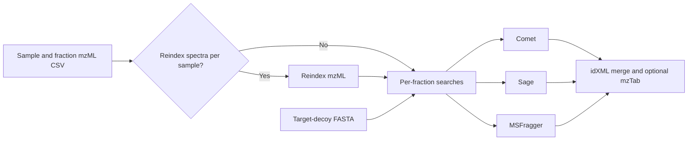

# pipeline-search-ProteomicMSMS

[](https://github.com/TheBoutrosLab/pipeline-search-ProteomicMSMS/actions/workflows/prepare-release.yaml)

- [pipeline-search-ProteomicMSMS](#pipeline-search-proteomicmsms)
  - [Overview](#overview)
  - [How To Run](#how-to-run)
  - [Pipeline Steps](#pipeline-steps)
  - [Inputs](#inputs)
    - [Input CSV](#input-csv)
    - [Config](#config)
  - [Outputs](#outputs)
  - [References](#references)
  - [License](#license)

## Overview

This Nextflow DSL2 pipeline searches tandem mass spectra against a supplied target-decoy FASTA. It supports the OpenMS Comet, Sage, and MSFragger adapters. One run can process multiple label-free samples or isobaric plexes, each optionally split across multiple mzML fractions. The pipeline keeps each fraction's unfiltered search results and produces one merged idXML per sample and selected engine. FDR estimation and PSM filtering belong to downstream validation.

---

## How To Run

1. Create a `.config` using the [template](config/template.config). Set `input_csv`, `output_dir`, `decoy_database`, and `search_engines`. Review each selected adapter's tolerances, digestion, modifications, decoy naming, and reported hit counts. See [residue modifications](docs/residue-modifications.md).

2. Create an input CSV using the [template](input/input.csv). Give each row a sample or plex name and an mzML path. List each sample's fractions in order.

3. If using MSFragger, obtain its JAR separately under its license and set `msfragger_executable`.

4. Initialize the Git submodules and run the pipeline with Nextflow, for example:

   ```bash
   export NXF_VER=24.10.6
   export NXF_SYNTAX_PARSER=v1
   nextflow run TheBoutrosLab/pipeline-search-ProteomicMSMS -r <version> -c config/my-run.config
   ```

   The supplied configuration template defaults to Docker. Use `-profile apptainer` or `-profile singularity` when appropriate for the execution environment. The `local` profile uses installed executables for development. The [`.env-template`](.env-template) records the Nextflow version and parser used by the shared SBP configuration modules, along with the root for external integration test data.

---

## Pipeline Steps



When `reindex_mzml` is enabled, the pipeline assigns unique scan numbers across each sample's fractions before searching. It preserves Thermo native ID syntax (`controllerType=0 controllerNumber=1 scan=N`) and writes `scan=N` for other input formats. Scan numbers may repeat between samples. The reindexed mzML files can also be used by downstream quantification.

For each selected engine, `create_json_*` serializes its nested tool configuration, `create_ini_*` writes an OpenMS INI, and `search_database_*` searches each fraction. `merge_idxml` combines fractions separately for each sample, and `export_mzTab` optionally exports each merged file. MSFragger can also run `fix_msfragger_spectrum_refs` before merging.

---

## Inputs

### Input CSV

The CSV has one mzML file per row. The `sample_name` and `path` columns are required; additional columns are ignored. Rows with the same `sample_name` are fractions of one sample or plex and are merged in their CSV order:

| Field | Required | Description |
| ----- | -------- | ----------- |
| `sample_name` | yes | Sample or plex name, using letters, digits, dots, underscores, or hyphens; must start with a letter or digit. |
| `path` | yes | Path to a fraction's mzML file. Relative paths resolve from the CSV directory. |

```csv
sample_name,path
sample-01,/data/sample_01_F1.mzML
sample-02,/data/sample_02_F1.mzML
sample-01,/data/sample_01_F2.mzML
```

The FASTA must contain target and decoy sequences with a convention matching each adapter's `PeptideIndexing` settings. The pipeline does not create decoys. Fractions of the same sample should have distinct basenames when `reindex_mzml = false`.

### Config

| Parameter | Type | Description |
| --------- | ---- | ----------- |
| `input_csv` | string(path) | Path to the input CSV file. |
| `output_dir` | string(path) | Root output directory. |
| `decoy_database` | string(path) | Target-decoy protein FASTA. |
| `search_engines` | list(string) | Nonempty subset of `Comet`, `Sage`, and `MSFragger`. |
| `msfragger_executable` | string(path) | MSFragger JAR; required when that engine is selected. |
| `CometAdapter`, `SageAdapter`, `MSFraggerAdapter` | namespace | Nested OpenMS adapter settings, converted to INI files. |
| `comet_default_params` | string(path) | Optional native Comet parameter file. |
| `reindex_mzml` | bool | Assign unique scan numbers across fractions of each sample. Defaults to `true`. |
| `reindex_mzml_keep_all_metadata` | bool | Preserve metadata when reindexing. Defaults to `true`. |
| `merge_proteins_add_PSMs` | bool | Merge proteins by accession while retaining PSMs. Defaults to `true`. |
| `fix_msfragger_spectrum_refs` | bool | Repair references for affected OpenMS/MSFragger combinations. Defaults to `false`. |
| `export_mzTab` | bool | Export merged idXML files to mzTab. Defaults to `true`. |
| `export_all_psms` | bool | Include every reported PSM in mzTab exports. Defaults to `true`. |
| `save_intermediate_files` | bool | Publish generated adapter INI files and other intermediates. Defaults to `false`. |
| `ucla_cds` | bool | Compatibility flag required by the shared execution setup. Keep `false` outside the legacy UCLA-CDS environment. |
| `work_dir` | string(path) | Optional location for Nextflow intermediate files. |
| `base_resource_update` | namespace | Optional per-process CPU and memory multipliers applied to default allocations. |

---

## Outputs

For each sample, final results are saved under `<output_dir>/search-ProteomicMSMS-<version>/<sample>/OpenMS-<version>/output/`:

| Output | Description |
| ------ | ----------- |
| `<sample>_<engine>.idXML` | Merged, unfiltered identifications for each selected engine. |
| `per_fraction/<engine>/` | Unfiltered fraction idXML files; MSFragger pepXML files are also retained. |
| `reindex_mzml/` | Reindexed mzML files, when enabled. |
| `*.mzTab` | Optional exports from merged idXML. |

Shared generated INI files are saved under `<output_dir>/search-ProteomicMSMS-<version>/intermediate/` when requested. Pipeline and process logs are stored in a timestamped `log-search-ProteomicMSMS-*` directory under the same run root.

---

## References

1. Pfeuffer et al. OpenMS 3 enables reproducible analysis of large-scale mass spectrometry data. *Nature Methods*, 21, 365–367 (2024). [doi:10.1038/s41592-024-02197-7](https://doi.org/10.1038/s41592-024-02197-7)
2. Eng et al. Comet: an open-source MS/MS sequence database search tool. *Proteomics*, 13, 22–24 (2013). [doi:10.1002/pmic.201200439](https://doi.org/10.1002/pmic.201200439)
3. Kong et al. MSFragger: ultrafast and comprehensive peptide identification in mass spectrometry–based proteomics. *Nature Methods*, 14, 513–520 (2017). [doi:10.1038/nmeth.4256](https://doi.org/10.1038/nmeth.4256)
4. Lazear. Sage: An Open-Source Tool for Fast Proteomics Searching and Quantification at Scale. *Journal of Proteome Research*, 22, 3652–3659 (2023). [doi:10.1021/acs.jproteome.3c00486](https://doi.org/10.1021/acs.jproteome.3c00486)

---

## License

pipeline-search-ProteomicMSMS is licensed under the GNU General Public License version 2. See [LICENSE](LICENSE) for the terms of the GNU GPL license.

pipeline-search-ProteomicMSMS

Search tandem mass spectra against a protein database using OpenMS adapters.

Copyright (C) 2026 Sanford Burnham Prebys Medical Discovery Institute ("Boutros Lab")

This program is free software; you can redistribute it and/or modify it under the terms of the GNU General Public License as published by the Free Software Foundation; either version 2 of the License, or (at your option) any later version.

This program is distributed in the hope that it will be useful, but WITHOUT ANY WARRANTY; without even the implied warranty of MERCHANTABILITY or FITNESS FOR A PARTICULAR PURPOSE. See the GNU General Public License for more details.
